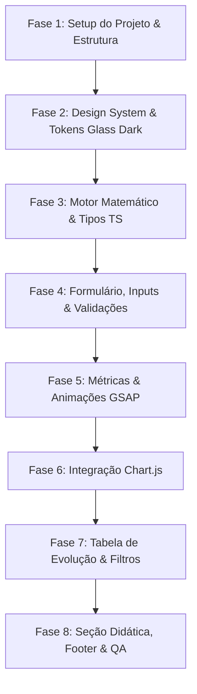

# 📋 Plano de Criação — Calculadora de Juros Compostos Online

> **Status:** Pronto para Implementação  
> **Tech Spec:** HTML5 + CSS3 Moderno + TypeScript (Vite)  
> **Skills Aplicadas:** `glass-dark-ui` + `gsap-frameworks`  
> **Responsividade:** Mobile-First (Full Responsive: Mobile, Tablet, Desktop)  
> **Referência:** [`ideia.md`](./ideia.md)

---

## 1. 🎯 Visão Geral do Projeto

O projeto consiste em uma aplicação web estática de alta performance, visualmente sofisticada e interativa para simulação de juros compostos com aportes periódicos. 

A interface adotará o estilo **Dark Glassmorphism** (Skill `glass-dark-ui`) com microinterações fluidas e contadores animados via **GSAP** (Skill `gsap-frameworks`), gráficos dinâmicos via **Chart.js** e tabela detalhada de evolução patrimonial mês a mês ou ano a ano.

---

## 2. 🛠️ Stack Tecnológica & Arquitetura

### 2.1 Tecnologias Principais
- **Bundler & Dev Server:** [Vite](https://vitejs.dev/) (Rápido, suporte nativo a TypeScript, ESM e hot reload instantâneo).
- **Linguagem:** **TypeScript** (Garante tipagem estrita para cálculos financeiros, modelos de dados e eventos do DOM).
- **Estilização:** **CSS3 Moderno** com Custom Properties (Design Tokens), Flexbox, CSS Grid, `backdrop-filter` e máscaras de gradiente.
- **Gráficos:** **Chart.js** (Leve, responsivo e customizável para tema dark).
- **Animações:** **GSAP 3** (`gsap` core) para transições de entrada, animação numérica tipo odômetro nos KPIs e revelação dinâmica dos resultados.
- **Ícones:** Lucide Icons (via CDN/SVG inline para manter leveza e estética minimalista).

### 2.2 Estrutura de Diretórios Recomendada
```text
calculadora_juros_compostos/
├── index.html              # Estrutura semântica da aplicação
├── package.json            # Scripts e dependências
├── tsconfig.json           # Configuração do TypeScript
├── vite.config.ts          # Configuração do Vite
├── public/
│   ├── favicon.svg         # Ícone do projeto
│   └── og-image.png        # Imagem para compartilhamento social
├── src/
│   ├── styles/
│   │   ├── tokens.css      # Variáveis de cores, fontes, glass tokens
│   │   ├── glass.css       # Regras da skill glass-dark-ui (.glass-panel, .border-gradient)
│   │   ├── base.css        # Reset, tipografia e estilos globais
│   │   ├── components.css  # Inputs, botões, cards de KPI, tabela
│   │   ├── charts.css      # Wrappers e containers dos gráficos
│   │   └── responsive.css  # Media queries e ajustes finos mobile/tablet
│   ├── types/
│   │   └── finance.ts      # Interfaces: InvestmentInput, MonthlyRecord, SimulationResult
│   ├── utils/
│   │   ├── formatters.ts   # Moeda BRL (Intl.NumberFormat), porcentagens e datas
│   │   └── masks.ts        # Máscaras de digitação em tempo real (R$, %, número)
│   ├── services/
│   │   └── calculator.ts   # Motor matemático financeiro (fórmula e projeção temporal)
│   ├── charts/
│   │   └── chartManager.ts # Inicialização, atualização e destruição dos gráficos Chart.js
│   ├── animations/
│   │   └── animManager.ts  # Animações GSAP (odômetro de números, stagger reveal)
│   └── main.ts             # Ponto de entrada, orquestração de eventos do formulário e render
└── ideia.md                # Documento original com a ideia do usuário
```

---

## 3. 🎨 Design System & Aplicação das Skills

### 3.1 Skill: `glass-dark-ui` (Superfícies & Profundidade)
A identidade visual seguirá um tema escuro futurista e elegante com efeito de vidro fosco:

- **Paleta de Tokens (`tokens.css`):**
  ```css
  :root {
    --bg-0: #020617;          /* Slate 950 ultra escuro */
    --bg-1: #0b1220;          /* Deep navy */
    --glass-fill: rgba(15, 23, 42, 0.55);
    --glass-fill-strong: rgba(15, 23, 42, 0.75);
    --glass-fill-subtle: rgba(30, 41, 59, 0.35);
    --text-main: #f8fafc;
    --text-muted: #94a3b8;
    --accent: #38bdf8;        /* Azul elétrico */
    --accent-glow: rgba(56, 189, 248, 0.35);
    --profit: #10b981;        /* Esmeralda para juros/rendimentos */
    --profit-glow: rgba(16, 185, 129, 0.25);
    --invested: #818cf8;      /* Índigo para valor investido */
    --danger: #f43f5e;        /* Limpar dados */
  }
  ```
- **Painéis de Vidro Fosco (`.glass-panel`):**
  - `backdrop-filter: blur(20px) saturate(140%)`
  - Gradiente linear de topo sutil com iluminação interna (`inset 0 1px 0 rgba(255, 255, 255, 0.12)`).
  - Sombra suave: `0 20px 48px rgba(2, 6, 23, 0.5)`.
- **Bordas com Máscara Gradiente (`.border-gradient`):**
  - Implementação via pseudo-elemento `::before` e `mask-composite: exclude` conforme a especificação da skill, dando um contorno iluminado sutil e refinado.
- **Acessibilidade e Contraste:**
  - Texto principal em `#f8fafc` e secundário em `#94a3b8` sobre fundos navy com opacidade equilibrada, atendendo o critério WCAG AA.

### 3.2 Skill: `gsap-frameworks` & Microinterações
- **Lifecycle & Scoping:**
  - Orquestração centralizada através de um gerenciador de animações com escopo controlado (`gsap.context`).
- **Animações Chave:**
  1. **Hero & Form Entrance:** Fade-up suave em cascata (`stagger: 0.08`) no carregamento inicial da página.
  2. **Contador Numérico Odométrico:** Ao calcular, os valores dos 3 cards de KPI (Total em Juros, Total Investido e Total Final) realizam um tween numérico de `0` até o valor final (`duration: 1.2`, `ease: "power2.out"`), formatando como `R$ 0,00` a cada frame.
  3. **Visual Feedback:** Efeito de "pulse" suave e brilho no card de resultado final.
  4. **Reset Animation:** Transição suave ao limpar campos sem "pulos" bruscos no layout.

---

## 4. 📐 Estrutura de Layout e Seções da Página

Seguindo a disposição definida em `ideia.md`:

```
┌──────────────────────────────────────────────────────────────┐
│ 1. HEADER / HERO SECTION                                     │
│    Título com gradiente de texto, subtítulo explicativo      │
├──────────────────────────────────────────────────────────────┤
│ 2. FORMULÁRIO DE SIMULAÇÃO (Glass Card)                     │
│    [Valor Inicial]           [Aporte Mensal]                 │
│    [Taxa de Juros] (Ano/Mês) [Período] (Anos/Meses)          │
│    [Botão Limpar]            [Botão Calcular (Principal)]    │
├──────────────────────────────────────────────────────────────┤
│ 3. RESULTADOS EM NÚMEROS (KPI Cards)                         │
│    ┌───────────────┐ ┌───────────────┐ ┌───────────────────┐ │
│    │ Total Invest. │ │ Total Juros   │ │ Total Final Acum. │ │
│    └───────────────┘ └───────────────┘ └───────────────────┘ │
├──────────────────────────────────────────────────────────────┤
│ 4. GRÁFICOS (Grid 2 Colunas)                                 │
│    ┌─────────────────────────┐ ┌─────────────────────────┐  │
│    │ Rosca: Invest. x Juros  │ │ Barras: Evolução Temporal│  │
│    └─────────────────────────┘ └─────────────────────────┘  │
├──────────────────────────────────────────────────────────────┤
│ 5. TABELA DE EVOLUÇÃO PATRIMONIAL                            │
│    Alternância: [Mês a Mês] | [Ano a Ano]                    │
│    [Tabela com scroll responsivo e paginação/virtualização] │
├──────────────────────────────────────────────────────────────┤
│ 6. GUIA DIDÁTICO / COMO É FEITO O CÁLCULO                   │
│    Explicação da fórmula M = P(1+i)^n, o poder dos juros,    │
│    diferença entre juros simples e compostos                 │
├──────────────────────────────────────────────────────────────┤
│ 7. FOOTER                                                    │
│    Desenvolvido por Arthur | GitHub @arthun01                │
└──────────────────────────────────────────────────────────────┘
```

---

## 5. 🧮 Motor Matemático Financeiro (`calculator.ts`)

### 5.1 Regras de Conversão
- **Taxa Anual para Mensal:**
  $$i_m = (1 + i_a)^{1/12} - 1$$
  *(Permitir no código alternância entre taxa composta real e divisão nominal $i_a / 12$, usando a taxa composta como padrão do mercado financeiro).*
- **Período:**
  - Se selecionado em anos: $n_{meses} = anos \times 12$.
  - Se selecionado em meses: $n_{meses} = meses$.

### 5.2 Simulação Mês a Mês
O cálculo iterativo garante precisão centavo a centavo e alimenta tanto os totais quanto os gráficos e tabela:

```typescript
export interface MonthRecord {
  period: number;          // Mês 1, 2, 3...
  year: number;            // Ano 1, 2...
  startingBalance: number; // Saldo anterior
  interestMonth: number;   // Juros gerados no mês
  contribution: number;    // Aporte do mês
  totalInvested: number;   // Soma dos aportes + inicial até o mês
  totalInterest: number;   // Soma de todos os juros até o mês
  finalBalance: number;    // Saldo final acumulado
}
```

**Algoritmo de Iteração:**
1. Inicializa: `saldo = valorInicial`, `totalInvestido = valorInicial`, `totalJuros = 0`.
2. Para cada mês $m$ de $1$ até $n$:
   - `rendimento = saldo * taxaMensal`
   - `saldo = saldo + rendimento + aporteMensal`
   - `totalInvestido += aporteMensal`
   - `totalJuros += rendimento`
   - Armazena o registro do mês.
3. Gera agregações agrupadas por ano para visualização "Ano a Ano" na tabela e nos gráficos.

---

## 6. 📊 Gráficos Interativos (Chart.js)

### 6.1 Gráfico de Proporção (Donut / Pizza)
- **Objetivo:** Mostrar o impacto dos juros no patrimônio final.
- **Séries:**
  - Total Investido (Cor `--invested`, ex: `#818cf8`)
  - Total em Juros (Cor `--profit`, ex: `#10b981`)
- **Visual:** Donut com corte central (`cutout: '70%'`) para exibir a porcentagem que os juros representam do total.

### 6.2 Gráfico de Evolução Patrimonial (Barras Empilhadas)
- **Objetivo:** Visualizar a "curva exponencial" do crescimento.
- **Eixo X:** Períodos (Mês 1..n ou Ano 1..n).
- **Eixo Y:** Valores em R$.
- **Séries empilhadas (`stacked: true`):**
  - Camada 1: Total Investido (base)
  - Camada 2: Total em Juros Acumulados (topo)
- **Tema:** Grid lines discretas em `rgba(255, 255, 255, 0.05)`, tooltips estilizadas em estilo dark glass.

---

## 7. 📱 Responsividade & Experiência Mobile-First

| Breakpoint | Dispositivo | Adaptação de Layout |
| :--- | :--- | :--- |
| `< 640px` | **Mobile** | • Inputs em 1 coluna vertical<br>• KPIs empilhados em 3 linhas compactas<br>• Gráficos empilhados em 1 coluna<br>• Tabela com container horizontal com indicador de scroll |
| `640px - 1024px` | **Tablet** | • Inputs em grid de 2 colunas<br>• KPIs em grid de 3 colunas compactas<br>• Gráficos em layout vertical amplo ou 2 colunas dependendo da orientação |
| `> 1024px` | **Desktop** | • Formulário otimizado em 2 ou 4 colunas harmônicas<br>• KPIs proeminentes com tipografia expansiva<br>• Gráficos lado a lado em 2 colunas simétricas<br>• Tabela expandida com visualização completa |

### Recursos de UX Essenciais:
- **Máscaras de Input:** Formatação automática enquanto o usuário digita (ex: digita `500000` -> vira `R$ 5.000,00`).
- **Validação Amigável:** Prevenção de valores negativos, prazos exorbitantes ou taxas inválidas com mensagens visuais sutis.
- **Botão Limpar:** Restaura valores padrão ou limpa os resultados de forma suave.
- **Alternador de Visualização da Tabela:** Toggle `[Mensal | Anual]` para não poluir telas pequenas com 360 linhas se o prazo for de 30 anos.

---

## 8. 🗺️ Roadmap de Execução Passo a Passo



### Detalhamento das Fases:

#### **Fase 1: Setup do Projeto & Dependências**
- Inicializar projeto Vite com TypeScript:
  - `npm create vite@latest . -- --template vanilla-ts` (ou configuração equivalente).
  - Instalar dependências: `chart.js`, `gsap`, `lucide` (se necessário).
- Configurar base HTML limpa e arquivo de entrada `src/main.ts`.

#### **Fase 2: Design System & CSS Glass Dark**
- Criar `src/styles/tokens.css` com paleta dark, tipografia (Inter / Poppins via Google Fonts).
- Implementar as classes `.glass-panel` e `.border-gradient` conforme as especificações da skill `glass-dark-ui`.
- Implementar botões de ação com estados de hover, active e focus ring acessível.

#### **Fase 3: Motor Matemático & Tipagem**
- Implementar `src/types/finance.ts`.
- Implementar `src/services/calculator.ts` com testes para validação matemática.
- Implementar formatador monetário `src/utils/formatters.ts` (`Intl.NumberFormat('pt-BR', ...)`).

#### **Fase 4: Formulário & Controles de Entrada**
- Montar a interface dos 4 campos de entrada com seletores de período e taxa.
- Adicionar máscaras de entrada em tempo real.
- Conectar botões "Calcular" e "Limpar".

#### **Fase 5: Cards de Resultados (KPIs) & Animações GSAP**
- Criar os 3 cards de resultado visual.
- Implementar tween numérico no `src/animations/animManager.ts` para contagem progressiva e suave.
- Aplicar efeito de fade/slide na primeira exibição dos resultados.

#### **Fase 6: Gráficos com Chart.js**
- Desenvolver `src/charts/chartManager.ts`.
- Configurar gráfico de rosca (Investido vs Juros) com paleta personalizada.
- Configurar gráfico de barras da evolução ao longo do tempo.
- Garantir atualização reativa a cada novo cálculo sem vazamento de memória (`chart.destroy()`).

#### **Fase 7: Tabela de Evolução**
- Estruturar a tabela com colunas: *Período*, *Juros do Mês/Ano*, *Total Investido*, *Total em Juros*, *Saldo Acumulado*.
- Criar toggle para alternar entre "Mês a Mês" e "Ano a Ano".
- Implementar scroll suave com sticky header.

#### **Fase 8: Seção Educativa, Footer & Polimento Final**
- Escrever seção didática explicando a matemática dos juros compostos com visual atraente.
- Montar o footer com créditos para Arthur e link direto para o GitHub: `https://github.com/arthun01`.
- Testar responsividade em resoluções mobile (320px, 375px, 414px) e desktop (1080p, 2K).
- Auditar contraste, performance (Lighthouse) e fluidez das animações.

---

## 9. 🧪 Critérios de Aceite & Validação

- [ ] **Fórmula Financeira:** Testar caso clássico (Ex: R$ 1.000 inicial, R$ 200/mês, 1% ao mês por 24 meses) e bater centavo por centavo com calculadoras de referência (Banco Central / Mobills).
- [ ] **Visual Glass Dark:** Efeitos de desfoque funcionando com fallback elegante, sem contraste inferior a 4.5:1 em textos normais.
- [ ] **Responsividade:** Sem barra de rolagem horizontal indesejada na tela em smartphones, tabela com rolagem interna contida.
- [ ] **Animações GSAP:** Contadores sem bugs numéricos (sem NaN durante a interpolação) e animação fluida a 60fps.
- [ ] **Gráficos:** Destruídos e recriados adequadamente a cada recálculo, redimensionando automaticamente na troca de orientação do aparelho.
- [ ] **Footer:** Link funcional apontando para `https://github.com/arthun01`.
